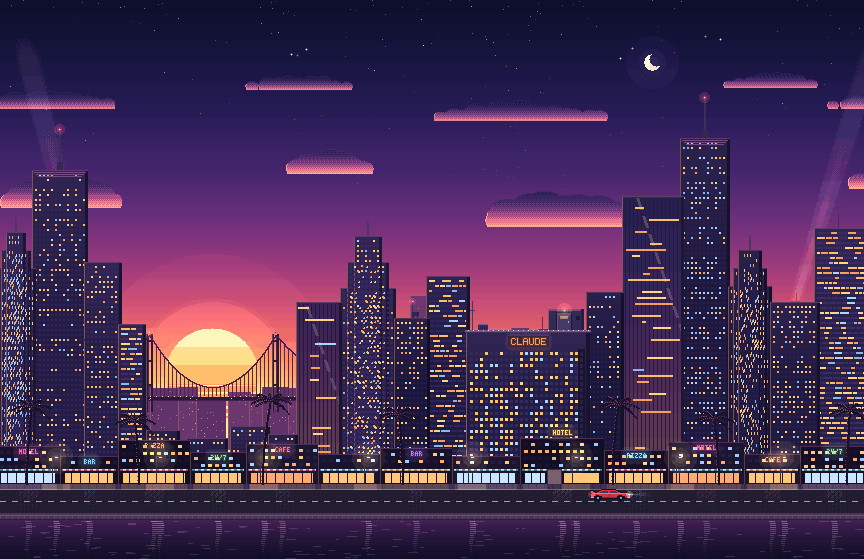

# Claude Parachute

Анимированные пиксельные обои для macOS. Вертолет пролетает над городом на закате, Claude выпрыгивает, раскрывает
парашют, садится на крышу небоскреба под неоновой вывеской CLAUDE, сворачивает купол, спускается по лестнице и уезжает
на такси. А вертолет разворачивается за следующим заходом.



[English](README.md)

## Установка

Вставить в Терминал (без sudo, без Xcode, больше ничего ставить не нужно):

```bash
curl -fsSL https://raw.githubusercontent.com/B0yko/claude-parachute-wallpaper/main/install.sh | bash
```

Та же строка обновляет. Удалить и вернуть прежние обои:

```bash
curl -fsSL https://raw.githubusercontent.com/B0yko/claude-parachute-wallpaper/main/install.sh | bash -s -- uninstall
```

Установщик скачивает релиз из этого репозитория, сверяет SHA-256, запускает самотест приложения, кладет
`Claude Parachute.app` в `~/Applications`, запоминает текущие обои, ставит кадр сцены статичными системными обоями и
добавляет автозапуск при входе. macOS может показать уведомление «Добавлены фоновые объекты»: это автозапуск.

## Управление

Все через ту же строку, `... | bash -s -- КОМАНДА`:

| Команда | Что делает |
|---|---|
| `status` | запущено ли, CPU, память, играет или на паузе |
| `pause`, `resume` | остановить / продолжить анимацию |
| `stop`, `start` | выключить (в том числе после перезагрузки) / включить |
| `mode visible` | анимировать всегда, когда обои видны |
| `mode desktop` | анимировать, только когда впереди рабочий стол (по умолчанию) |
| `battery pause` | на батарее стоять |
| `battery play` | на батарее играть (по умолчанию) |
| `check` | скачать и проверить релиз, прогнать самотест, ничего не меняя |
| `uninstall` | удалить все и вернуть прежние обои |

Без интернета тот же скрипт лежит внутри приложения:
`~/Applications/Claude\ Parachute.app/Contents/Resources/claude-parachute.sh status`.

## Почему почти не тратит железо

- **Играет, только когда смотришь.** По умолчанию анимация идет, когда впереди рабочий стол (клик по столу или все
  приложения скрыты) и он хоть частично виден. Пока ты работаешь в приложении, обои стоят картинкой. Только по окнам
  судить нельзя: macOS считает обои видимыми за любым окном, не помеченным как непрозрачное (полупрозрачные панели,
  многие Electron-приложения), и WindowServer композитил бы анимацию, которую никто не видит.
- **Пауза**, когда спят дисплеи, идет заставка, экран заблокирован, активен другой пользователь, включен режим
  энергосбережения, Mac перегрет и, по желанию, на батарее. На паузе 0% CPU. Сон Mac и дисплеев не блокирует.
- **Маленькое видео.** В видео сам пиксель-арт, 864x560 при 24 fps (HEVC 4:4:4, свой цвет у каждого пикселя, края
  точные). Декодирует аппаратный блок, увеличивает композитор без сглаживания. Это 1/16 пикселей экрана.
- **Тихие полосы.** Под полупрозрачными меню и Dock стоит неподвижный кадр, и macOS не размывает обои заново 24 раза
  в секунду. В этих полосах сцены ничего не движется (тест проверяет каждый кадр). При большом Dock или экране другой
  формы там тоже идет видео.

Замер на MacBook Pro M5 Pro, рабочий стол виден, анимация идет:

| | CPU приложения | GPU | WindowServer CPU |
|---|---|---|---|
| без живых обоев | 0 | 0% | 0,2% |
| первая версия (3456x2234, 60 fps, видео на весь экран) | 4,5% | 14% | 20% |
| этот релиз | 1,3% | около 0% | 6% |
| впереди любое приложение (режим по умолчанию) | 0% | 0% | без изменений |

## Требования

- macOS 13 Ventura и новее, Apple Silicon или Intel (универсальное приложение; на Intel видео декодируется
  программно, при таком размере это дешево).
- Любой экран. На 16" MacBook Pro (3456x2234) каждый пиксель арта ровно 4x4 пикселя экрана, на других экранах та же
  четкая картинка с чуть неравными пикселями.
- Никаких разрешений: ни записи экрана, ни универсального доступа, ни сети после установки, ни аналитики.

## Сборка из исходников

Нужны Command Line Tools от Xcode, Python 3 и ffmpeg с libx265 (`brew install ffmpeg`).

```bash
git clone https://github.com/B0yko/claude-parachute-wallpaper && cd claude-parachute-wallpaper
./chute test        # тесты сцены (создаст .venv с numpy и pillow)
./chute build       # рендер видео (около 20 с) и сборка универсального приложения в build/
./chute install     # поставить эту сборку теми же шагами, что и однострочник
```

`./chute preview 9.5 30` рисует кадры для просмотра. Сюжет живет в классе `Story` в `render/scene.py`.

## Лицензия

MIT, см. [LICENSE](LICENSE). Фанатский проект, не связан с Anthropic и не одобрен ею; Claude и его маскот
принадлежат Anthropic.
